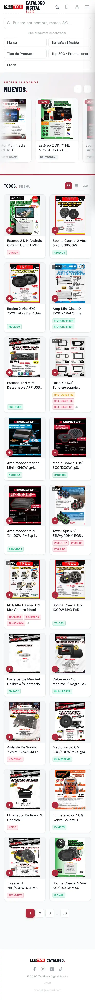
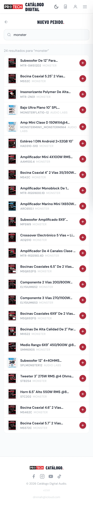

# DNNNAH — Creative Workspace

**Donnovan · Frontend Developer + AI-Assisted Engineering**

Un portafolio para leer, explorar e inspeccionar. DNNNAH presenta mi trabajo, mi proceso y las decisiones detrás de cada proyecto en una interfaz que toma prestado el lenguaje de un IDE: archivos, pestañas y una terminal con personalidad propia.

> Diseño la lógica. Dirijo la creación. Respondo por el resultado.

[Recorrido](#recorrido) · [Workspace y Terminal](#workspace-y-terminal) · [Desarrollo local](#desarrollo-local) · [Contacto y despliegue](#contacto-y-despliegue) · [Pruebas](#pruebas)

## Recorrido

La navbar sticky sigue la sección visible y reúne cinco entradas:

| Archivo en la interfaz | Contenido | Fragmento |
| --- | --- | --- |
| `hero.tsx` | Presentación, frases rotativas con pausa y acceso al trabajo | `#main` |
| `about.md` | Biografía, proceso y trayectoria | `#about` |
| `skills.ts` | Tecnologías agrupadas y su uso | `#skills` |
| `projects/` | Galería y acceso a los casos de estudio | `#projects` |
| `contact.tsx` | Formulario, perfiles y cierre editorial | `#contact` |

Son nombres de navegación; los archivos de implementación están organizados por componentes.

### Trabajo seleccionado

- **Protech** — PWA freelance remunerada para audio y accesorios automotrices. Caso ampliado en `#projects/protech`: problema, accesos por rol, experiencia móvil, modelo de datos, automatización y desarrollo asistido por IA, con capturas reales.
- **PawPass** — identidad digital de mascotas; proyecto académico incompleto. Caso en `#projects/pawpass`.
- **NutrIA** — PWA de nutrición; proyecto académico incompleto. Caso en `#projects/nutria`.
- **DNNNAH Runtime** — etapa anterior del portafolio con temática Go. Caso en `#projects/dnnnah-runtime`.

Los otros tres casos presentan contexto, enfoque y límites en un formato más breve. Las tarjetas de la galería usan composiciones abstractas identificadas como tales. Las tecnologías descritas en cada caso pertenecen a ese proyecto: no son necesariamente dependencias de este portafolio.

<details>
<summary>Capturas versionadas de Protech</summary>

Estas imágenes muestran la aplicación Protech, no la interfaz de DNNNAH. También se utilizan dentro de su caso de estudio.

<p>
  
  
</p>

</details>

## Identidad visual

**Editorial Playground 75/25**: una base editorial que da espacio al contenido y una capa de juego para quien quiera explorar. Tipografía grande, composición asimétrica, etiquetas de archivo y detalles interactivos.

La paleta vive en `src/styles/index.css`: crema **#F6F5F0**, tinta **#171717**, lima **#B8FF65** y lavanda **#D9CDFF**. Space Grotesk, Inter y JetBrains Mono se sirven localmente mediante Fontsource. El sistema combina grid de 12 columnas, espaciado base de 4 px y tipografía fluida.

## Workspace y Terminal

**Workspace** se abre desde el menú. Ofrece explorador, documentos de lectura, pestañas seleccionables y cerrables, barra de estado y el archivo `secret.ts`. En móvil, el explorador se despliega desde «Archivos». No edita ni guarda código; las pestañas duran mientras el modo permanece abierto.

**Terminal** se abre desde el menú o con **CMD+K** en Apple y **Ctrl+K** en Windows/Linux. El atajo abre esta terminal; **Command Palette está pospuesta**.

```text
help                 comandos principales y teclado
ls                   archivos del portafolio virtual
cat about.md         leer una sección
open projects/       navegar a proyectos
skills / stack       tecnologías documentadas
projects             explorar los cuatro casos
whoami               presentación
hire                 abrir Contact
contact              canales públicos
cv                   disponibilidad del currículum
clear / exit         limpiar respuestas o salir
```

Hay historial con ↑/↓ y autocompletado con Tab. `easter` revela más pistas, incluidos `git status`, `git log --oneline`, `git blame`, `matrix` y el café imaginario. Los comandos usan un vocabulario cerrado: no ejecutan shell ni consultan el Git local. `contact --msg "texto"` devuelve un 503 simulado; no envía mensajes.

Workspace y Terminal son diálogos excluyentes, con navegación por teclado, cierre con Escape y gestión de foco.

### Detalles para quien inspecciona

- **Konami** (`↑ ↑ ↓ ↓ ← → ← → B A`): simula CSS roto durante tres segundos y restaura la vista con confeti. Es un reset visual temporal; no elimina las hojas de estilo.
- **Cursores fantasma**: hasta seis visitantes con personalidades tras inactividad con ratón en escritorio. Se retiran al volver la actividad; no hacen clic ni capturan eventos.
- **Consola del navegador**: saludo ASCII de DNNNAH y `HIRE ME`.
- **Resize y scroll intensos**: avisos localizados que se pueden volver a activar tras una pausa.
- **Tres activaciones del monograma D.**: una pista hacia `secret.ts`. El archivo permite explorar el intercambio reversible de acentos.
- **`sudo rm -rf /`**: contraseña ficticia visual, progreso y remate de broma. Cancelable con Ctrl+C; no pide una contraseña real ni toca archivos.

El audio se sintetiza con Web Audio, tiene perfiles para la página, Workspace y Terminal, y empieza apagado en una visita sin preferencia guardada. La elección se conserva en almacenamiento local. Los cursores y detectores de resize/scroll no reproducen sonido. Más detalles en [Easter eggs](docs/easter-eggs.md).

## Tecnologías y arquitectura

React 19 y TypeScript 6 sobre Vite 8, Tailwind CSS 4 con su plugin de Vite y CSS propio. Lucide aporta iconos y React Mockframe los marcos de dispositivo del caso Protech. Las versiones resueltas están en `package-lock.json`.

`App` compone las secciones, comparte el idioma y coordina los modos. La navegación interna usa fragmentos y el historial del navegador, sin biblioteca de routing. Protech se carga de forma diferida. El contenido está separado en módulos por sección; los modos reutilizan esos datos.

```text
src/
  app/                 composición, idioma y navegación
  components/          hero, about, skills, projects, contact,
                       navigation, workspace, terminal, playground y ui
  i18n/                mensajes compartidos y tipos ES/EN
  seo/                 metadatos y generación de robots/sitemap
  styles/              tokens y estilos globales
api/contact.ts         adaptador de servidor para Vercel
server/contact.ts      validación y envío mediante proveedores externos
tests/                 pruebas unitarias y scripts de navegador
public/                favicon, imagen social e iconos de tecnologías
capturas-funcionalidades/  material real de Protech
docs/                  notas de implementación y verificación
```

### Idiomas y accesibilidad

Contenido en **ES/EN**, con español por defecto. Inglés se puede solicitar mediante `?lang=en` o la entrada `/en/`; el selector actualiza la URL, `document.lang` y los metadatos. El idioma se comparte con Workspace y Terminal, sin inferirlo del navegador.

Hay enlace para saltar al contenido, foco visible, controles semánticos, estados anunciados y etiquetas/errores asociados al formulario. `prefers-reduced-motion` reduce o suprime efectos: los fantasmas no aparecen y las escenas de Terminal se adaptan. Estas medidas y sus pruebas no equivalen a una auditoría completa de accesibilidad.

## Desarrollo local

Requiere **Node.js 22.12 o posterior y npm**; comprobado en esta revisión con Node 26.9.0 y npm 11.19.1.

```sh
git clone https://github.com/dnnnah/DNNNAH-Creative-Workspace.git
cd DNNNAH-Creative-Workspace
npm ci
npm run dev
```

Vite muestra la dirección local al iniciar. No necesitas credenciales para recorrer el portafolio, Workspace, Terminal o los casos.

| Comando | Función |
| --- | --- |
| `npm run dev` | Servidor de desarrollo |
| `npm run typecheck` | TypeScript sin emitir archivos |
| `npm run lint` | ESLint sin advertencias permitidas |
| `npm test` | Pruebas unitarias con Vitest |
| `npm run build` | Typecheck y compilación en `dist/` |
| `npm run preview` | Previsualización local del build |
| `npm run check` | Typecheck, lint, pruebas unitarias y build |
| `npm run test:workspace` | Pruebas de navegador de Workspace |
| `npm run test:terminal` | Pruebas de navegador de Terminal |
| `npm run test:terminal:update` | Ampliaciones y atajos de Terminal |
| `npm run test:navigation-contact` | Navegación y presentación de Contact |

## Contacto y despliegue

**El envío del formulario está desactivado por defecto.** Los campos permiten redactar, pero Vite y una publicación estática de `dist/` no ejecutan `/api/contact`. El repositorio contiene un adaptador para Vercel Functions; su presencia no confirma un despliegue ni la entrega real de correos.

La configuración está documentada en [.env.example](.env.example). Para ajustes públicos locales puedes copiarla a `.env.local`:

```sh
cp .env.example .env.local
```

- **Públicas, incluidas en el cliente:** `VITE_SITE_URL`, `VITE_CONTACT_ENABLED`, `VITE_TURNSTILE_SITE_KEY`.
- **Privadas, solo en servidor:** `CONTACT_ORIGIN`, `TURNSTILE_SECRET_KEY`, `UPSTASH_REDIS_REST_URL`, `UPSTASH_REDIS_REST_TOKEN`, `RESEND_API_KEY`, `CONTACT_FROM`, `CONTACT_TO`.

Nunca pongas secretos en variables `VITE_` ni los subas a Git. Mantén `VITE_CONTACT_ENABLED=false` hasta verificar la función y sus proveedores: Cloudflare Turnstile, Upstash Redis y Resend. La activación completa se explica en [Contacto](docs/contact.md).

El servidor verifica origen exacto, POST JSON, tamaño y campos; valida Turnstile en servidor y limita solicitudes por IP mediante Redis. Si faltan configuración, IP confiable o el servicio de rate limit, rechaza el envío. El destinatario procede del entorno del servidor y el correo usa texto plano. Las pruebas locales sustituyen proveedores; la recepción real sigue requiriendo validación en el despliegue.

El build genera entrada inglesa, `robots.txt`, sitemap y metadatos sociales. Configura `VITE_SITE_URL` con el origen confirmado antes de publicar: el código tiene `https://dnnnah.dev` como fallback, lo que no demuestra que ese dominio esté desplegado. No se presenta aquí una demo pública del portafolio sin verificar.

Canales configurados: [GitHub](https://github.com/dnnnah), [LinkedIn](https://www.linkedin.com/in/donnovan-tc/) y [correo](mailto:dnnnah@icloud.com). El CV está pendiente en `src/components/contact/links.ts`.

## Pruebas

```sh
npm run check
```

La suite unitaria cubre idioma, secciones, navegación, comandos, validación de contacto, metadatos, contratos de accesibilidad y detectores del Playground.

Para las pruebas de navegador necesitas **Playwright y Chromium disponibles por separado**; no están declarados como dependencias del proyecto. Arranca la aplicación y ejecuta los scripts en otra terminal:

```sh
npm run dev -- --host 127.0.0.1 --port 5179
# En otra terminal:
npm run test:workspace
npm run test:terminal
npm run test:terminal:update
npm run test:navigation-contact
```

Los scripts admiten `PLAYWRIGHT_MODULE`, `CHROMIUM_PATH` y `PORTFOLIO_URL` para señalar instalaciones y servidor existentes. En `tests/browser/` también hay pruebas de easter eggs, audio y scroll; sus opciones específicas están en [la documentación de easter eggs](docs/easter-eggs.md).

La evidencia documentada usa Chromium y tamaños de pantalla simulados. Quedan fuera de esa evidencia los dispositivos físicos, Safari/Firefox, lectores de pantalla reales y la entrega de correo. No se publican puntuaciones Lighthouse ni métricas de rendimiento sin una medición reproducible.

## Estado y próximos pasos

Las secciones, cuatro casos, Workspace, Terminal y Playground están implementados. El trabajo pendiente se concentra en:

- Retomar **Command Palette** cuando se defina su alcance.
- Enriquecer los casos breves con proceso y material verificable, siguiendo el desarrollo editorial de Protech.
- Confirmar hosting, origen público, credenciales y recepción del formulario; incorporar el CV.
- Ampliar la validación de accesibilidad y compatibilidad en navegadores y dispositivos reales.

Las notas de `docs/` conservan contexto de distintas etapas; algunas describen estados anteriores. Para los scripts y el comportamiento actual, contrastar con `package.json` y el código.

## Autoría y créditos

Creado por **Donnovan**, con desarrollo asistido por IA y responsabilidad sobre la arquitectura y el resultado.

Las fuentes se distribuyen mediante Fontsource. Las procedencias y licencias de iconos de tecnologías están en [public/skills/SOURCES.md](public/skills/SOURCES.md); las marcas pertenecen a sus titulares. Las dependencias conservan sus propias licencias.

Este repositorio no incluye un archivo `LICENSE` de alcance general; no se declara una licencia de reutilización para el código, textos o capturas del portafolio.
